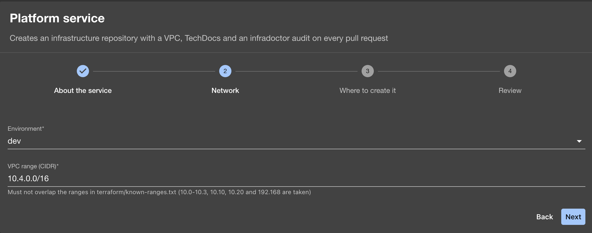
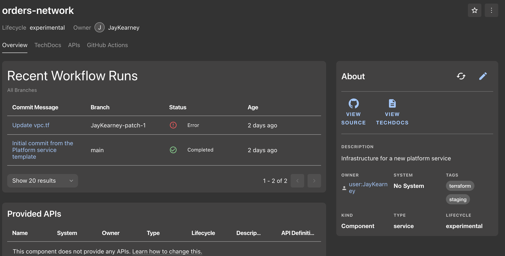

# JK Platform Lab: developer portal

A [Backstage](https://backstage.io) developer portal where a new infrastructure repository is created
from a form, and comes with its standards already in place: an audit on every pull request, a
protected `main` branch, documentation and a catalog entry.



## What it does

**Golden path templates.** The **Platform service** template asks for a name, an owner, an
environment and a VPC range, then creates a GitHub repository with:

- Terraform for the VPC, filled in from the form
- a [infradoctor](https://github.com/marketplace/actions/infradoctor) workflow that checks the VPC
  does not overlap any range already in use, on every push and pull request
- branch protection on `main`: pull requests only, the audit must pass, squash merges only
- topics and custom properties (`environment`, `managed-by`) set on the repository
- TechDocs and a `catalog-info.yaml`, so it appears in the portal with an owner and documentation


**Catalog with GitHub discovery.** Every repository in the organization with a `catalog-info.yaml`
is added automatically, so nobody has to register a new service by hand.

**TechDocs.** Documentation lives next to the code in Markdown and is published in the portal.

**CI/CD view.** Each component shows its GitHub Actions runs.



## How it fits together

```
 Backstage form ──► fetch:template ──► publish:github ──► catalog:register
                    (skeleton files)   (repo, branch       (portal entry)
                                        protection,
                                        properties)
                                             │
                                             ▼
                                   first commit runs the
                                   infradoctor audit
```

| Repository | Role |
|---|---|
| this repository | The Backstage app, production image and Docker Compose setup |
| [backstage-templates](https://github.com/jk-platform-lab/backstage-templates) | The software templates, and a troubleshooting guide |
| [infradoctor](https://github.com/JayKearney/infradoctor) | The CLI and GitHub Action that audits network ranges |

## Running it locally

### Requirements

- Docker Desktop
- A GitHub OAuth app for sign-in, with the callback URL
  `http://localhost:7007/api/auth/github/handler/frame`
- A fine-grained GitHub token for the organization, with these repository permissions:
  Administration, Contents, Workflows, Pull requests, Custom properties (read and write);
  Commit statuses and Metadata (read); and Repository creation for the organization

### 1. Secrets

Secrets are kept in two files **next to** the repository folder, never inside it:

`../github-auth.env`

```text
AUTH_GITHUB_CLIENT_ID=...
AUTH_GITHUB_CLIENT_SECRET=...
GITHUB_TOKEN=...
```

`../postgres.env`

```text
POSTGRES_USER=backstage
POSTGRES_PASSWORD=...
POSTGRES_HOST=backstage-db
POSTGRES_PORT=5432
```

Restrict both with `chmod 600`.

### 2. Your user

Sign-in only works for users in the catalog. Set your GitHub username in `examples/org.yaml`
(`metadata.name` and the `github.com/user-name` annotation).

### 3. Build and start

```bash
docker network create backstage-net
docker volume create backstage-db-data

yarn install
yarn tsc
yarn build:backend --config ../../app-config.yaml --config ../../app-config.production.yaml

docker compose up -d --build
```

Open <http://localhost:7007>.

| Command | What it does |
|---|---|
| `docker compose up -d` | Start Postgres, then the portal once Postgres is healthy |
| `docker compose logs -f backstage` | Follow the portal's log |
| `docker compose down` | Stop and remove the containers (the data stays in the volume) |

### Releasing a change

The frontend is built into the bundle, so a change to code or `app-config` needs a new build:

1. `yarn build:backend --config ../../app-config.yaml --config ../../app-config.production.yaml`
2. Raise the image tag in `docker-compose.yaml` (for example `0.1.1` to `0.1.2`)
3. `docker compose up -d --build`

To roll back, set the previous tag and run `docker compose up -d`.

## Production setup

| Choice | Why |
|---|---|
| PostgreSQL in its own container, data in a named volume | The catalog, template runs and search index survive restarts and container rebuilds |
| Secrets only as environment variables at start-up | Nothing secret in the image, the config files or Git |
| Postgres port not published | Only the portal can reach the database |
| Image runs as the `node` user | Not root inside the container |
| mkdocs installed in a virtual environment at a pinned version | TechDocs builds the same way every time |
| Dependencies installed before the app is copied | Rebuilds after a config change take seconds |
| Versioned image tags | Each release can be rolled back |

## Notes on current Backstage

Many tutorials predate recent changes. Things that work differently now:

- **New backend system:** plugins and modules are added with one `backend.add(import(...))` line.
- **New frontend system:** with `app.packages: all`, a frontend plugin is enabled by installing it.
- **Community plugins** such as GitHub Actions moved to `@backstage-community/*`.
- **Fine-grained tokens** need each permission granted explicitly; the
  [troubleshooting guide](https://github.com/jk-platform-lab/backstage-templates/blob/main/docs/troubleshooting.md)
  lists which request needs which permission.
- **Config lists are replaced, not merged** between config files, so `catalog.locations` must be
  complete in each file that sets it.

## Status

A personal lab for platform engineering practice. It runs locally and is not deployed publicly.